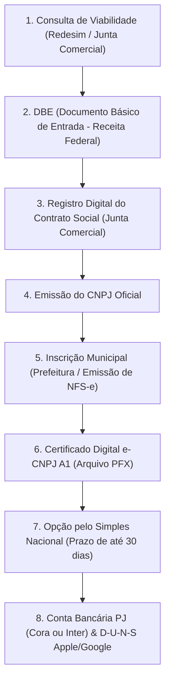

# 🏛️ Playbook de Abertura do CNPJ Soberano (`03_PLAYBOOK_ABERTURA_CNPJ_SOBERANO.md`)

> **Objetivo:** Roteiro prático, enxuto e descomplicado para a formalização da Sociedade Limitada Unipessoal (SLU) da Yresá, maximizando a autonomia do fundador e reduzindo os custos de abertura a zero (ou apenas às taxas públicas obrigatórias).

---

## 1. Parâmetros Fundacionais da Empresa

Antes de iniciar qualquer protocolo no portal da Redesim:

| Campo | Definição Canônica Yresá | Observações Práticas |
| :--- | :--- | :--- |
| **Razão Social** | `Yresa Tecnologia e Inteligencia Ltda` *(sugestão)* | A razão social da SLU deve conter o termo identificador e a terminação "Ltda". |
| **Nome Fantasia** | `Yresá` | O nome público de marca que constará no cartão do CNPJ. |
| **Natureza Jurídica** | `206-2 - Sociedade Empresária Limitada` | SLU é uma Limitada com apenas 1 sócio (100% de quotas). |
| **Porte da Empresa** | `Microempresa (ME)` | Limite de faturamento de até R$ 360.000,00/ano no Simples Nacional. |
| **Capital Social** | `R$ 1.000,00 a R$ 5.000,00` | Não há valor mínimo exigido por lei. Pode ser integralizado em moeda corrente. |
| **Endereço Fiscal** | Coworking / Sede Virtual ou Residencial | Para desenvolvimento de software puro, prefeituras costumam aceitar endereço residencial (sem atendimento presencial) ou sede virtual de coworking. |
| **CNAE Principal** | `6203-1/00` | Desenvolvimento e licenciamento de programas de computador customizáveis. |
| **CNAEs Secundários** | `6311-9/00`, `6319-4/00`, `6202-3/00`, `6209-1/00` | Tratamento de dados, provedores de aplicação, suporte e portais web. |

---

## 2. Passo a Passo da Abertura Digital (Redesim / Gov.br)

Todo o processo moderno de abertura de empresas no Brasil é 100% digital e pode ser assinado com a sua conta **Gov.br (Nível Prata ou Ouro)** sem necessidade de gastar com despachantes:

### Etapa 1: Consulta Prévia de Viabilidade
* Acesse o portal da Junta Comercial do seu Estado (ou diretamente pelo portal nacional da **Redesim** ➔ *Abrir Pessoa Jurídica*).
* Preencha a viabilidade de nome empresarial (para garantir que não existe outra razão social idêntica no Estado) e a viabilidade locacional do endereço da sede.

### Etapa 2: DBE no Coletor Nacional da Receita Federal
* Com a viabilidade aprovada, acesse o **Coletor Nacional da Redesim** e selecione *"Inscrição de Primeiro Estabelecimento"*.
* Insira os CNAEs mapeados, os dados do sócio único (Lucas Alencar - 100% das quotas) e informe que a administração cabe ao sócio único.
* O sistema gerará o código do **DBE (Documento Básico de Entrada)**.

### Etapa 3: Contrato Social Padrão e Registro na Junta Comercial
* A maioria das Juntas Comerciais modernas (JUCESP, JUCERJA, JUCEMG, etc.) oferece o **Contrato Social Padrão** gerado automaticamente no próprio sistema da Junta com cláusulas prontas para SLU.
* Você assina o contrato digitalmente usando a sua conta **Gov.br** (dispensando reconhecimento de firma em cartório).
* Pague a taxa estadual da Junta Comercial (DARE/DAE) diretamente pelo internet banking.

### Etapa 4: Emissão do CNPJ
* Assim que a Junta aprova o registro digital, o número do **CNPJ é gerado automaticamente** e disponibilizado para consulta no site da Receita Federal.

### Etapa 5: Inscrição Municipal & Alvará de Funcionamento
* No município da sede da empresa, efetue o cadastro municipal (CCM / Inscrição Municipal).
* Como o CNAE de software é de baixo risco (sem estoque de produtos e sem circulação de público), a dispensa de alvará sanitário e ambiental do Corpo de Bombeiros é concedida de forma automática e instantânea pelo portal municipal.

### Etapa 6: Emissão do Certificado Digital e-CNPJ A1
* **Regra Fundamental de Soberania Técnica:** Compre um certificado **e-CNPJ Tipo A1 em arquivo** (geralmente emitido por videoconferência em 15 minutos via Serasa, Certisign ou Valid por ~R$ 150 a R$ 200 com validade de 1 ano).
* **NUNCA compre o Tipo A3 (cartão/token USB):** O certificado A1 é um arquivo digital `.pfx` com senha. Isso permite que você faça upload no Asaas para automação de NFS-e ou suba na plataforma de contabilidade sem precisar plugar pendrive físico no computador.

### Etapa 7: Enquadramento no Simples Nacional
* ⚠️ **Atenção Máxima ao Prazo:** A solicitação de opção pelo Simples Nacional deve ser feita no portal do Simples Nacional em até **30 dias contados do último deferimento de inscrição (municipal)** e até **60 dias da inscrição no CNPJ**.
* Se perder essa janela, a empresa só poderá entrar no Simples Nacional em janeiro do ano seguinte, sendo obrigada a operar pelo Lucro Presumido (com impostos muito mais altos).

### Etapa 8: Conta Bancária PJ e Ecossistema Apple/Google
1. **Conta PJ:** Abra conta digital com custo zero em bancos nativos para tecnologia (como **Banco Inter Empresas** ou **Cora**). Ambas oferecem emissão gratuita de extratos em OFX/CSV e suporte a Pix PJ gratuito.
2. **Número D-U-N-S:** Solicite o número D-U-N-S gratuito da Dun & Bradstreet com os dados do CNPJ. Ele é o requisito obrigatório da Apple para transformar sua conta pessoal de desenvolvedor em uma conta corporativa da Yresá.
