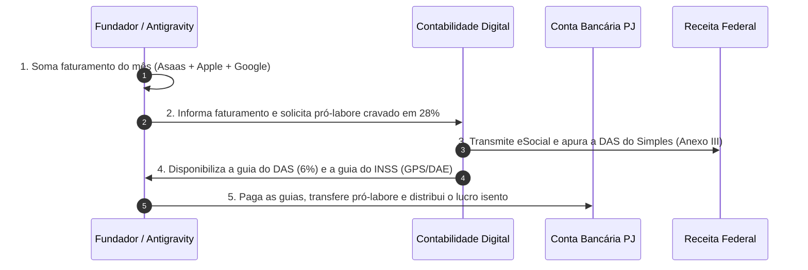

# 🧮 Simulador e Modelo Matemático do Fator "R" & Pró-Labore (`03_SIMULADOR_FATOR_R_E_PRO_LABORE.md`)

> **Objetivo:** Fornecer ao fundador a equação exata, a tabela comparativa de economia tributária e o roteiro mensal para manter o faturamento da Yresá sempre tributado na menor alíquota legal (Anexo III - 6,00% em vez do Anexo V - 15,50%).

---

## 1. A Equação Canônica do Fator "R"

Conforme a Lei Complementar nº 123/2006 (Art. 18, § 5º-J), a tributação das atividades de desenvolvimento e licenciamento de software (`CNAE 6203-1/00`) depende da razão entre a folha de pagamento e a receita bruta acumulada dos últimos 12 meses:

$$\text{Fator R} = \frac{\sum_{t=1}^{12} \text{Folha de Salários / Pró-Labore}_t}{\sum_{t=1}^{12} \text{Receita Bruta}_t}$$

* **Regra de Ouro:**
  - **Se $\text{Fator R} < 0,28$ (menos de 28%):** A empresa é jogada no **Anexo V**, pagando alíquota inicial de **15,50%** sobre o faturamento.
  - **Se $\text{Fator R} \ge 0,28$ (28% ou mais):** A empresa é enquadrada no **Anexo III**, pagando alíquota inicial reduzida de apenas **6,00%** sobre o faturamento.

---

## 2. A Mecânica da Tributação: Pró-Labore vs. Distribuição de Lucros

Para quem não tem funcionários contratados via CLT, a "Folha de Salários" é composta exclusivamente pelo **Pró-Labore do Fundador**:

1. **Pró-Labore (Remuneração do Trabalho do Administrador):**
   - É tributado pelo **INSS do Contribuinte Individual (11%)** recolhido na DCTFWeb/eSocial.
   - Sofre incidência da Tabela Progressiva do IRPF (apenas sobre a parcela que exceder a faixa de isenção de IRPF, que em 2026/2026 é de aproximadamente R$ 2.259,20 ou R$ 2.824,00 com desconto simplificado).
2. **Distribuição de Lucros (Remuneração do Capital):**
   - **100% ISENTA de Imposto de Renda (IRPF)** e **ISENTA de INSS**.
   - Todo o saldo que sobra na conta bancária da empresa após o pagamento dos custos de nuvem/IA, do DAS (Simples Nacional), do pró-labore e do INSS pode ser transferido para a conta de pessoa física (CPF) do fundador como lucro isento.

---

## 3. Matriz Comparativa: Cenário Real de Economia

Abaixo, a comparação entre pagar o imposto sem pró-labore (Anexo V) versus aplicar a estratégia ativa do Fator R (Anexo III):

| Faturamento Mensal | Cenário A: Anexo V (15,5%) Sem Pró-Labore | Cenário B: Fator R (Anexo III a 6% + Pró-Labore 28%) | Economia Real Líquida Mensal | Economia Anual Acumulada |
| :---: | :---: | :---: | :---: | :---: |
| **R$ 5.000,00** | R$ 775,00 (DAS) | • DAS (6%): R$ 300,00<br>• Pró-Labore: R$ 1.412,00 (mínimo)<br>• INSS (11%): R$ 155,32<br>• IRPF: R$ 0,00<br>**Total Encargos: R$ 455,32** | **+ R$ 319,68** | **~ R$ 3.836,16** |
| **R$ 10.000,00** | R$ 1.550,00 (DAS) | • DAS (6%): R$ 600,00<br>• Pró-Labore (28%): R$ 2.800,00<br>• INSS (11%): R$ 308,00<br>• IRPF (simplificado): R$ 0,00 a R$ 15,00<br>**Total Encargos: R$ 923,00** | **+ R$ 627,00** | **~ R$ 7.524,00** |
| **R$ 20.000,00** | R$ 3.100,00 (DAS) | • DAS (6%): R$ 1.200,00<br>• Pró-Labore (28%): R$ 5.600,00<br>• INSS (11%): R$ 616,00<br>• IRPF s/ pró-labore: ~R$ 480,00<br>**Total Encargos: R$ 2.296,00** | **+ R$ 804,00** | **~ R$ 9.648,00** |
| **R$ 30.000,00** | R$ 4.650,00 (DAS) | • DAS (6%): R$ 1.800,00<br>• Pró-Labore: R$ 8.400,00<br>• INSS (11% limitado ao teto ~R$ 850)<br>• IRPF s/ pró-labore: ~R$ 1.150,00<br>**Total Encargos: R$ 3.800,00** | **+ R$ 850,00** | **~ R$ 10.200,00** |

> 💡 **Nota de Segurança:** Mesmo pagando o INSS de 11% sobre o pró-labore, a empresa economiza entre **R$ 7.500 a R$ 10.000 por ano** em impostos, além de garantir a cobertura previdenciária do fundador (tempo de contribuição e aposentadoria).

---

## 4. O Ritual Mensal em 4 Passos

Todo primeiro dia útil do mês subsequente ao fechamento:



---

## 5. Script Auxiliar em Python (`calc_fator_r.py`)

Você pode rodar este script rápido a qualquer momento para checar os valores exatos:

```python
def calcular_fator_r(faturamento_mensal: float):
    pro_labore_ideal = faturamento_mensal * 0.28
    
    # Salário mínimo de referência
    salario_minimo = 1412.00
    if pro_labore_ideal < salario_minimo:
        pro_labore = salario_minimo
    else:
        pro_labore = pro_labore_ideal
        
    das_anexo_iii = faturamento_mensal * 0.06
    das_anexo_v_sem_fator = faturamento_mensal * 0.155
    
    inss_pro_labore = pro_labore * 0.11
    
    print(f"--- SIMULAÇÃO YRESÁ (Faturamento: R$ {faturamento_mensal:,.2f}) ---")
    print(f"Pró-Labore Recomendado (28%): R$ {pro_labore:,.2f}")
    print(f"INSS s/ Pró-Labore (11%):     R$ {inss_pro_labore:,.2f}")
    print(f"Imposto DAS (Anexo III a 6%): R$ {das_anexo_iii:,.2f}")
    print(f"Custo Tributário Total:       R$ {(das_anexo_iii + inss_pro_labore):,.2f}")
    print(f"Se estivesse no Anexo V (15,5%): R$ {das_anexo_v_sem_fator:,.2f}")
    print(f"Economia Estimada do Mês:     R$ {(das_anexo_v_sem_fator - (das_anexo_iii + inss_pro_labore)):,.2f}")

# Exemplo de teste:
# calcular_fator_r(10000.00)
```
